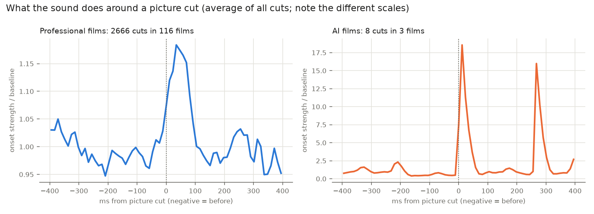
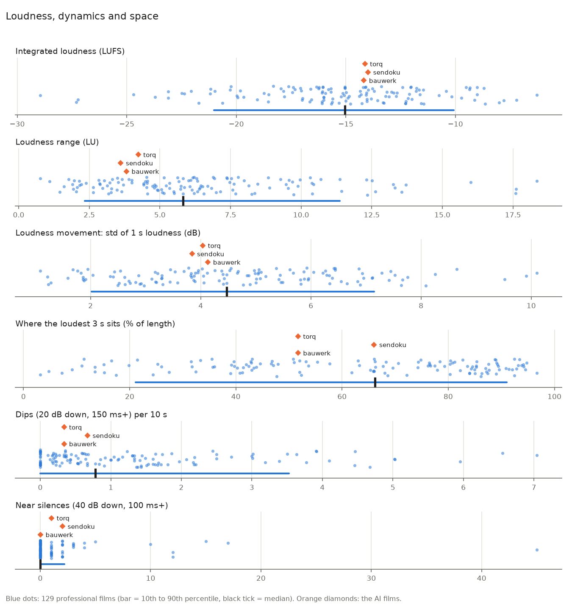
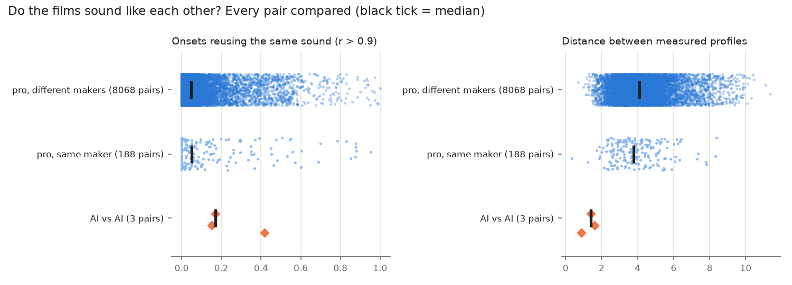

# Restraint and variety make motion graphics sound expensive

Professional motion graphics sound is a small functional vocabulary (movement sounds such as whooshes, anticipation sounds such as risers, arrival sounds such as impacts, clicks and pops, identity sounds such as tonal hits and sonic logos, and a glue layer of beds and textures) that is placed by hierarchy rather than on every event, locked within about a frame of the picture for contact sounds, and given contrast by dropping level rather than adding it. When 129 professional product and brand films were measured against three films made by the mgpro code pipeline, the AI films were not wrong on any single headline number: their loudness, onset density, stereo width and loudness arc all sat inside the professional range. What makes them sound generic is that **they are the same film three times** (a profile distance of 0.88 to 1.60 between them, against a median of 4.1 between professional films, all three at 120.2 BPM, all at -14.0 to -14.2 LUFS, all with one gap at exactly 13.75 s), and that they sit at the same edge of the range on a few axes: onsets locked to the 16th note grid, a brighter spectrum, a loudness range of 3.6 to 4.2 LU against a professional 5.8, a first second already at full level, and **every picture cut slammed with a hit 18.6 times the baseline onset strength where professional films average 1.18 times**. Underneath, the numpy synthesizer rings roughly ten times longer than real interface sounds, makes pure tones with no pitch movement, renders in mono and routes seven different events to one sound. The fixes are measurable rather than matters of taste: enforce distance from earlier films, use short dips instead of dead air, save hits for structural cuts, darken the mix, and draw real material from libraries whose licences allow commercial use without credit, of which only Kenney (CC0) and the Sonniss GDC bundles are also scriptable. For delivery, one master at -14 LUFS integrated and -1 dBTP covers web, YouTube and social; broadcast needs its own -23 LUFS (EBU R128) or -24 LKFS (ATSC A/85) mix.

## Five sound jobs cover almost every motion graphics event

Adobe Research describes motion graphics sound as having "unique challenges due to their short, abstract nature", and that framing explains the vocabulary: sounds in this genre are gestures that describe motion and weight, not literal foley ([Adobe Research, MoSound](https://research.adobe.com/publication/mosound-an-interactive-tool-for-generative-sound-design-in-motion-graphics/)). Practitioner sources converge on five jobs. **Movement** sounds (whoosh, swish) follow the speed, mass, direction and stopping point of the motion ([Sonilo](https://sonilo.com/ai-music/whoosh-sound-effect-guide)). **Anticipation** sounds (riser, reverse swell) build into a moment and stop on it. **Arrival** sounds (impact, click, pop, sub drop) mark the instant an object lands; one guide insists the landing layer is used "only when the object visibly stops, attaches, or appears" ([Aisha Sound](https://aishasound.com/blog/whoosh-sound-design-a-practical-guide)). **Identity** sounds (tonal hit, sting, sonic logo) carry the brand, and **glue** (bed, texture, ambience) holds the space together underneath. A Krotos breakdown of a Rubik's cube spot shows all five at once: a warm musical bed, swirly synths pitched to follow the cube's spins, "bubbly sounds and rubbery stretches that rise and fall in pitch" as cubes morph into spheres, discrete swishes as movement accents, and a wave that grows as the camera moves in ([Krotos](https://krotos.studio/blog/sound-effects-motion-graphics-tips)).

| Job | Typical sounds | Visual trigger | Sourced or measured shape |
|---|---|---|---|
| Movement | whoosh, swish | element flies in, camera push, transition | 0.25 to 0.5 s for UI swipes and fast cuts, 0.5 to 1 s general, 1 s or more for big title reveals ([Violet Recording](https://violetrecording.com/how-to-make-whoosh-sounds/)) |
| Anticipation | riser, reverse swell, downlifter | build before a reveal or section change | one or two beats for a quick lift, four to eight bars for big tension, peak on beat one of the new section then cut or duck ([Violet Recording](https://violetrecording.com/how-to-make-risers-and-sweeps/)) |
| Arrival | impact, click, pop, thud, sub drop | contact, snap, dock, appear | clicks 30 to 120 ms, hovers 15 to 45 ms, success 100 to 300 ms, error 150 to 600 ms ([ui-sounds.com](https://ui-sounds.com/)) |
| Identity | tonal hit, sting, sonic logo | logo, product reveal, end card | YouTube's sonic logo runs about 3 s with a clear beginning and end ([Antfood Labs](https://www.antfood.com/labs/crafting-youtubes-first-sonic-brand)) |
| Glue | bed, pad, texture, ambience | under everything | warm musical bed for a calm background space ([Krotos](https://krotos.studio/blog/sound-effects-motion-graphics-tips)) |

The durations sources quote are file lengths, and the part a viewer actually hears is far shorter. In a measured library of 1,126 CC0 sounds, clicks run a median 167 ms to the -40 dB point but **drop 20 dB in only 8 to 26 ms**, and impacts carry a 150 to 450 ms tail but fall 20 dB in 17 to 71 ms; only bells and chimes keep their audible body above 100 ms ([mgpro library analysis](</home/wopler/.claude/skills/mgpro/sfx/ANALYSIS.md>)). Vendor numbers also conflict, with one guide putting hovers at 120 to 200 ms against 15 to 45 ms elsewhere ([SFX Engine](https://sfxengine.com/blog/sound-effects-click)), so the measured decay figures are the safer target. Within a set, size signals importance: navigation sounds should be the smallest and lightest, selections slightly bigger, and confirmations the biggest and most detailed ([SFX Engine](https://sfxengine.com/blog/best-practices-for-game-ui-sounds)).

### Layers own frequency bands and share one transient

Every sourced recipe reduces to a few constructions. An impact is a transient (a short bright noise burst), a body (midrange that identifies the material), a sub (felt weight) and a tail (reverb that places it in space); **one layer owns the sub, the others are rolled off below it, and all layers align on the same transient**, because small timing shifts between transient and body change perceived size and punch dramatically, and a thin hit usually lacks a layer rather than needing another plugin ([Violet Recording, impacts](https://violetrecording.com/how-to-make-impact-sounds/); [Morphic](https://morphic.com/resources/how-to/how-to-layer-sound-effects)). A whoosh starts as a filter sweep on noise that rises then falls over about 0.8 s, with pink noise smoother than white, a swell into the centre, a pitch rise as the object approaches and a fall as it passes, and a pan across the field ([Violet Recording, whooshes](https://violetrecording.com/how-to-make-whoosh-sounds/)); Krotos layers four complementary characters, such as airy high noise plus a liquid texture, and ties them with a group bus ([Krotos](https://sound.krotosaudio.com/whoosh-sound-effects/)). A riser should accelerate exponentially rather than climb linearly, be high-passed so it does not pile energy below 100 Hz into the drop, and use one primary motion (filter for noise risers, pitch for tonal ones) rather than pushing pitch, filter and volume at once ([Violet Recording, risers](https://violetrecording.com/how-to-make-risers-and-sweeps/)), with the noise layer about 6 dB under the tonal one ([Unison](https://unison.audio/how-to-create-risers/)).

Booms and sub drops are a sine near 50 Hz with a phase reset and a tiny noise click ([Ableton forum](https://forum.ableton.com/viewtopic.php?p=903916)), a pitch envelope of 1 to 2 semitones over 10 to 30 ms or 2 to 4 semitones over 20 to 50 ms, and a 2 to 4 s amplitude decay ([Audeobox](https://www.audeobox.com/learn/fl-studio/how-to-make-808s-in-fl-studio/)). A clean sine sub disappears on small speakers, so saturation is added to let harmonics carry the pitch ([Violet Recording, 808](https://violetrecording.com/how-to-design-an-808/)). The braam (low brass, synth and sub through distortion) shares the bass range with the music, and running both at full weight "turns to mud" ([IRPR](https://sounddesign.irpr.agency/glossary/braam/)). For interface sounds, the most portable recipe comes from a Python devlog: a linear attack of 2 ms that "must not be zero", an exponential release, a 3 ms fade to exactly zero, a soft square built from a sine plus the 3rd harmonic at 1/3 and the 5th at 1/5, DC removal, harmonics kept below about 8 kHz and every file peak-normalised to -3 dBFS; its click layers 12 ms of noise low-passed at 4 kHz over a 40 ms sine gliding from 1,800 to 1,200 Hz, and its confirm and cancel use one timbre that "answers two ways" (660 then 990 Hz, a perfect fifth up, against 520 then 350 drooping to 330 Hz) ([yetiancai](https://yetiancai.itch.io/cozy-ui-sfx-190/devlog/1730801/synthesizing-game-ui-sound-effects-with-code)).

The measured library refines these recipes in a way the tutorials miss. **A real object moving through air is a low "whum" with a whistle, not hiss**: fast swishes run 60 to 160 ms with a centroid of 190 to 600 Hz and nearly all energy below 2 kHz, heavy swings run 290 to 510 ms with 80 to 88% of their energy in 120 to 500 Hz, and only designed "airy" transitions sit at 5 to 13 kHz, which reads as digital ([mgpro library analysis](</home/wopler/.claude/skills/mgpro/sfx/ANALYSIS.md>)). A good click drops 20 dB in 4 to 18 ms, attacks in under 1 to 3 ms, centres at 1.9 to 4.6 kHz with under 10% of its energy below 500 Hz, and often falls 10 to 14 semitones within 40 ms; even the heaviest library hits keep 22 to 33% of their energy in 120 to 500 Hz, which is the part a phone speaker can actually play (same source).

### Size sets pitch, material sets decay, the score sets the notes

Bigger objects get lower, slower and longer sounds ([Krotos](https://sound.krotosaudio.com/whoosh-sound-effects/)); light airy whooshes suit text and menus while dark, distorted, low-passed ones suit heavy objects ([Violet Recording](https://violetrecording.com/how-to-make-whoosh-sounds/)). Material is a spectrum and decay problem, which is why modal synthesis (a sum of independently decaying sinusoids) has been perceptually evaluated for ceramic, glass, metal and wood ([SMC 2019](https://www.smc2019.uma.es/articles/P1/P1_05_SMC2019_paper.pdf)). The most concrete pitch method tunes every tonal effect to one scale: a C major pentatonic set guarantees that any two UI sounds form a consonant interval, confirm plays C5, E5, A5 in sequence, a toggle rises for on and falls for off, and error is a note plus the same note a semitone up because "the clash is the message" ([heyheythere](https://heyheythere.itch.io/soft-ui-sfx/devlog/1685319/ui-sounds-that-dont-clash-pitch-them-all-from-one-pentatonic-scale)). Taps, swishes and page turns stay as band-passed noise so they have no pitch to clash (same source). Generalising that scale from UI sounds to every tonal effect, with its root set to the soundtrack key, is the natural rule for a code pipeline.

## Contact sounds land on the frame; anticipation sounds end on it

Human tolerance for audio and picture offset is asymmetric. ITU-R BT.1359 puts the detectability threshold at about **45 ms of audio lead and 125 ms of audio lag**, and the acceptability limit at about 90 ms lead and 185 ms lag ([Wikipedia, audio to video sync](https://en.wikipedia.org/wiki/Audio-to-video_synchronization); [TV Technology](https://www.tvtechnology.com/opinions/av-synchronization-how-bad-is-bad)). At 30 fps that is 1.35 frames early or 3.75 frames late before anyone notices. EBU R37 asks for +40 ms to -60 ms end to end (same Wikipedia source), and Netflix delivery QC, as quoted in search snippets of a page now behind a login, treats sync effects 1 frame off as minor and 2 or more frames as an issue to fix ([Netflix Partner Help](https://backlothelp.netflix.com/hc/en-us/articles/115000533952-Sync-Effects)). Practitioners argue the direction: one Gearspace mixer says "sound-early is always worse than sound-late" because early never happens in nature ([Gearspace](https://gearspace.com/threads/sync-issues.1192176/)), while a vendor guide says "a hair early often reads better than late" when a cue on the frame still feels late, usually because the visual peaks 1 to 2 frames after contact or the sample has a slow attack ([Morphic](https://morphic.com/resources/how-to/how-to-sync-sound-effects-to-video)). Both positions fit inside the standard: impacts, taps and logo hits belong on the contact frame or at most one frame early.

Anticipation sounds follow the opposite logic. A whoosh starts before the edit and lands its peak on the first frame of the new shot, because a transition sound placed entirely after the cut "always feels late" ([Morphic, transitions](https://morphic.com/resources/sounds/transition-sound-effects)); for a 0.5 s transition, a whoosh of "roughly 400-500 ms" starts just before the frames change, impacts land on the cut because "even 50 ms early reads as sloppy", and a riser sits about "the second ahead of your key claim" ([Zella](https://zellahq.com/blog/sound-design-at-cuts-whoosh-impact-riser/)). Reverse whooshes swell and stop dead where the moment lands, so the edit falls into silence, which "hits harder" than a sound that continues through the cut ([add.app](https://add.app/sound-effects/sound-design-for-trailers-hits-rises-drones-pulses/)). Trailer editor Derek Lieu adds the split edit: audio often starts before the previous scene ends to foreshadow the next, while hits go on title card slams and whooshes go with dips to black, dissolves and lens flares ([Derek Lieu](https://www.derek-lieu.com/blog/2022/1/17/secrets-to-trailer-sound-design)). In motion graphics the audio track usually locks timing before the picture is animated ([Larry Jordan](https://larryjordan.com/articles/create-the-audio-first-for-a-motion-graphic-video/)).

The measurements show what professionals actually do at cuts, and it is far gentler than the tutorials imply. **Across 2,666 detected cuts in 116 professional films, onset strength at the cut rises to only 1.18 times its baseline**, peaking 35 ms after the cut (about 23 ms once the analysis hop lag is removed); per film the cut peak is a median 1.7 times baseline and lands a median 12 ms after the cut, with the 10th to 90th percentile spanning 58 ms before to 70 ms after ([film measurements](<../research_notes/Sound design in motion graphics/real_films_measured.md>)). Only 72% of cuts have an onset within 2 frames, against a chance level of 64% for a busy track, so most cuts are carried by the music rather than marked by an effect. The range of strategies is wide: Wise's design system film has 97% of its 70 cuts on an onset (chance 85%, median offset -2 ms), a film cut to its own music; Apple's iPhone 15 Pro film hits 83% against 43% chance; ManvsMachine's "Versus" hits only 44% against 20% chance with sound slightly before the cut; Monzo has no pulse at all and lets effects follow the picture 39 ms late; Stripe Sessions 2024 sits exactly at chance, its 82 cuts carried by continuous texture (same source).

### Rhythm ranks below emotion and story

Walter Murch's Rule of Six weights a cut's value as emotion 51%, story 23% and **rhythm only 10%**, with lower criteria never allowed to override higher ones ([No Film School](https://nofilmschool.com/2016/11/6-rules-good-cutting-according-oscar-winning-editor-walter-murch)). Tempo evidence for ads is real but narrow: a Journal of Advertising Research study of 26,025 video ads plus three experiments found fast music raises purchase intent and willingness to pay for promotion-focused ads, through time pressure rather than arousal, with no effect for prevention-focused ads ([ARF / JAR](https://thearf.org/access-knowledge-2/publications/journal-of-advertising-research/when-fast-music-makes-ads-more-persuasive-and-when-it-doesnt/)), while a Leicester thesis found slow music gave higher recall and more positive affect ([University of Leicester](https://figshare.le.ac.uk/articles/thesis/Cognitive_and_affective_responses_to_music_in_ads_and_service_environments/10153406)). The academic line between slow and fast is usually 94 BPM ([Immerse Education PDF](https://www.immerse.education/wp-content/uploads/2024/04/Effects-of-fast-tempo-background-music.pdf)). Density guidance is qualitative: sound section changes, punch-ins and reveals, not every join, because a video cutting every 4 to 5 s with a sound on each one "sounds like a percussion track" ([Zella](https://zellahq.com/blog/sound-design-at-cuts-whoosh-impact-riser/)); trailers carry well over a dozen SFX tracks, but the skill "doesn't come from the quantity of sound" ([Derek Lieu](https://www.derek-lieu.com/blog/2022/1/17/secrets-to-trailer-sound-design)).

The film measurements supply the numbers the literature lacks. Professional tempo spreads from 108 BPM (10th percentile) to 148 BPM (90th), median 123, and only 18% of films fall between 117 and 123 BPM; **29% of professional films have no clear pulse at all**, built on pads, swells and voice rather than a beat. Median onset density is 4.0 per second, the busiest 2 s window carries a median 7.0 per second, and density stays near its median until about 85% of the film before thinning for the end card ([film measurements](<../research_notes/Sound design in motion graphics/real_films_measured.md>)). These figures include voiceover in many professional films, which pushes density up slightly.

## Contrast comes from dipping, not from getting louder

Trailer sound designers say a braam is "only huge because of the beat of near-silence right before it" ([add.app](https://add.app/sound-effects/sound-design-for-trailers-hits-rises-drones-pulses/)), and "without quiet, your loud moments have nothing to contrast against" ([Violet Recording](https://violetrecording.com/sound-design-for-trailers/)). Broadcast rules enforce the same logic: EBU R128 s1 for adverts caps short-term loudness at -18 LUFS on a -23 LUFS programme, so **the loudest moment of a spot can be at most 5 LU above its average**, and the only way to make a payoff feel bigger is to make what precedes it quieter ([EBU R128 s1](https://tech.ebu.ch/docs/r/r128s1.pdf)). Because every platform normalises integrated loudness, a dynamic mix costs nothing in perceived level. Over-compression even backfires: one commercial mixer notes that heavily compressed spots can make the voice sound quieter than less compressed ones once everything is normalised, and uses only a couple of dB of multiband and limiting on the bus ([Gearspace](https://gearspace.com/board/post-production-forum/1276450-mix-bus-processing-tv-commercials.html)).

The measured films show that professionals create this contrast with short dips rather than silence. **83% of professional films contain at least one dip (20 dB down for 150 ms or more), a median of 4 per film, while 71% contain no near silence (40 dB down) at all.** In 57% of films a dip is a "re-entry": it lasts a median 0.30 s (10th to 90th percentile 0.15 to 0.95 s), the sound returns a median 9.3 dB louder (6.5 to 15.7 dB), and the first new onset lands a median 41 ms after the dip ends (11 to 240 ms), so the return is close to the grid but not on it ([film measurements](<../research_notes/Sound design in motion graphics/real_films_measured.md>)). Dips cluster in the first 10% of a film (an opening breath) and again at 90 to 95% (before the end card). Individual films show the range: Notion's "Introducing Notion AI" dips at 88% and returns 25 dB louder into its densest two seconds, Tendril's Microsoft emoji film drops for 1.3 s at 62% before its loudest second, and Samsung's One UI 5 film returns 31 dB louder on a sustained chord with 1.6 s before the next onset, a swell rather than a hit (same source).

The overall shape varies more than any template assumes. Professional loudness range has a median of 5.8 LU, a 10th percentile of 2.35 and a 90th of 11.4, and tonal films go much further (Linear Agent 17.6 LU, Raycast 13.6 LU). **The loudest 3 s sits anywhere from 21% to 91% of the length (median 66%)**: 16% of films peak in the first third, 32% in the middle and 52% in the last. The first second sits a median 1.9 LU below integrated loudness, with the 10th percentile 18.6 LU below, and up to 0.45 s of silence before the first sound is normal ([film measurements](<../research_notes/Sound design in motion graphics/real_films_measured.md>)).

### Music sits 18 to 20 dB under voice, and ducking stays shallow

With voiceover, a common starting balance places music 18 to 20 dB below speech and SFX 12 to 18 dB below it ([Pure Audio Insight](https://pureaudioinsight.com/blogs/content-production/background-music-volume-how-loud-should-it-be)), though featured cut sounds can sit around 6 dB under speech ([Zella](https://zellahq.com/blog/sound-design-at-cuts-whoosh-impact-riser/)); the two figures apply to different roles, ambient effects against featured transitions. Krotos puts music around -20 dB and hits between -20 and -10 dB, with real peaks allowed louder ([Krotos](https://krotos.studio/blog/how-to-balance-music-and-sound-effects)). Ducking guidance compiled from editing tools starts at 6 to 10 dB of reduction with a 30 to 80 ms attack and a 300 to 500 ms release (lengthened to 400 to 700 ms if the music pumps), and names **over-ducking by 15 to 20 dB on every line as the most common mistake** ([Vindral](https://composer-docs.vindral.com/operators/operators-sidechain-ducking.html); [DaVinci Resolve Club](https://davinciresolveclub.com/davinci-resolve-audio-ducking.md)). A broadcast commercial mixer sets the voice to spec first and handles most collisions with fader automation, using only a couple of dB of voice-keyed ducking ([Gearspace](https://gearspace.com/board/post-production-forum/1276450-mix-bus-processing-tv-commercials.html)). EQ carving cuts music in 1.2 to 2.4 kHz for consonants and treats 2 to 5 kHz as presence, with 1 to 3 dB moves sounding more natural than deep notches ([DV Info Net](https://www.dvinfo.net/forum/archive/index.php/t-41476.html); [DaVinci Resolve Club](https://davinciresolveclub.com/fairlight-eq-dialogue.md)).

Most product motion graphics have no voice, and no source gives ducking settings for music against SFX. The measured AI films show what goes wrong when a pipeline improvises one: they pull the level to half in the 150 ms before every cut, a gesture professionals reserve for a re-entry moment or two ([film measurements](<../research_notes/Sound design in motion graphics/real_films_measured.md>)).

### Phone speakers and muted feeds set the floor

Small speakers cannot reproduce bass fundamentals, but the ear infers a missing fundamental from its harmonics ([Wikipedia, missing fundamental](https://en.wikipedia.org/wiki/Missing_fundamental)), and harmonic synthesis such as Waves MaxxBass or multiband saturation extends perceived bass "about two octaves below its physical limitation" ([Production Expert](https://www.production-expert.com/production-expert-1/how-to-make-sure-bass-is-heard-on-small-speaker-devices)). The method is to duplicate the bass, saturate it, high-pass the copy and blend it back lightly ([FaderPro](https://blog.faderpro.com/mixing/mixing-bass-for-all-speaker-sizes/)). Many viewers never hear the sound at all: a 2019 Verizon Media and Publicis study found 69% watch video with sound off in public, and captions made viewers 80% more likely to finish ([Rev](https://www.rev.com/blog/speech-to-text-accessibility/top-7-places-you-need-to-watch-videos-on-mute)), while the widely quoted "85% of Facebook video watched without sound" traces to 2016 internal data ([Hypebot](https://www.hypebot.com/85-watch-your-videos-with-the-sound-off-plus-what-you-can-do-about-it.md)). These figures are old and secondhand, and no current platform data was found, but they mean every beat the music carries must also be visible in the motion.

## Web masters at -14 LUFS, broadcast at -23 or -24

Broadcast is the only area with hard, published specs. Web and social platforms publish nothing official, so YouTube's measured -14 LUFS (which only turns loud uploads down) has become the working reference.

| Destination | Integrated loudness | True peak | Other rules | Source |
|---|---|---|---|---|
| EU broadcast ads (EBU R128 s1) | -23.0 LUFS, ±0.2 LU | -1 dBTP | short-term max -18 LUFS; no LRA requirement for short form | [EBU R128 s1](https://tech.ebu.ch/docs/r/r128s1.pdf) |
| US broadcast (ATSC A/85, CALM Act) | -24 LKFS | -2 dBTP | mandatory for US TV ads | [Fora Soft 2026](https://www.forasoft.com/learn/audio-for-video/articles-audio/lufs-targets-per-platform-2026) |
| Netflix | -27 LKFS dialogue gated, ±2 LU | -2 dBTP | falls back to about -24 LKFS full programme | [Fora Soft 2026](https://www.forasoft.com/learn/audio-for-video/articles-audio/lufs-targets-per-platform-2026) |
| YouTube | -14 LUFS (measured, turn down only) | -1 dBTP | a -10 LUFS upload is lowered 4 dB | [Fora Soft 2026](https://www.forasoft.com/learn/audio-for-video/articles-audio/lufs-targets-per-platform-2026) |
| TikTok, Instagram, Meta | no published target | -1 dBTP advised | Meta uses adaptive loudness; creators often master at -10 to -12 LUFS | [Fora Soft 2026](https://www.forasoft.com/learn/audio-for-video/articles-audio/lufs-targets-per-platform-2026) |
| Streaming audio guidance (AES TD1008) | music -16, speech -18, mixed -17 LUFS | -1 dBTP | | [Fora Soft 2026](https://www.forasoft.com/learn/audio-for-video/articles-audio/lufs-targets-per-platform-2026) |
| Apple App Store previews | none published | none published | stereo, 256 kbps AAC, 44.1 or 48 kHz, 15 to 30 s, max 30 fps | [Apple](https://developer.apple.com/help/app-store-connect/reference/app-information/app-preview-specifications) |
| Cinema ads | about 82 dB Leq(m) on Dolby metering | | keep the mix dynamic | [Avid DUC](https://duc.avid.com/archive/index.php/t-280573.html) |

Vendor claims that Instagram and TikTok "prefer" -12 to -10 LUFS have no official backing ([Opus](https://opus.pro/blog/best-loudness-normalizers)). The practical answer is one master at -14 LUFS integrated and -1 dBTP (or -2 dBTP for anything lossy encoded) for web, YouTube, app stores and social, plus a separate broadcast mix. The measured professional films confirm that web practice is loose: their integrated loudness spreads from -21.0 to -10.1 LUFS (10th to 90th percentile, median -15.0), and their true peak median of -0.67 dBTP with a 90th percentile of +0.43 dBTP shows many uploads exceed -1 dBTP, though those peaks were measured after YouTube's lossy encoding, which raises inter-sample peaks ([film measurements](<../research_notes/Sound design in motion graphics/real_films_measured.md>)). Three AI films mastered to -14.0, -14.1 and -14.2 LUFS are therefore correct for YouTube and suspicious as a set: they look like one preset.

## Top studios decide sound at concept and build it from the product

The studios with public statements agree on three habits. Antfood, BUCK's frequent sound partner, wants to be involved "from concept and pre-production", treats sound design, music and audio post as one discipline that asks "what sound can do for the idea or message", and explores widely, sometimes through "30, 50 or 100 ideas", before narrowing ([Motionographer](https://motionographer.com/2018/09/05/the-other-half-with-antfood/)). Wes Slover of Sono Sanctus and Sanctus Audio starts from the job the audio must do (capture attention, reduce friction, build confidence or stay in the background) before deciding how it sounds, avoids temp tracks because "demo love can be really hard to break", and uses story arc as the stock versus custom test: a library track holds one mood, while a film with a real journey or precise hit moments needs a custom score ([By The Booth](https://www.bythebooth.com/insights/creative-tangent-wesley-slover-sound-the-invisible-brand-layer)). He also argues that sonic branding "shouldn't stop at an audio logo" and should extend into UX sounds so marketing and product feel like one brand (same source).

The documented case studies show three strategies. **Tight scoring to fast animation**: Antfood's music and sound for BUCK's Apple iMac Pro film, "tightly scored" around a developing synth beat, won a 2019 ADC Bronze for sound design craft ([Antfood](https://antfood.com/work/apple-imac)). **A palette built from the brand's own sounds**: Apple's event opener "Start Up: 45 Years of Apple Sounds" built a whole track from Apple device sounds, "No fillers. No mixing studio." ([D&AD 2022](https://dandad.org/awards/professional/2022/236414/event-opener-start-up-45-years-of-apple-sounds)), and Brabantia built its sonic branding from recordings of its own products ([Brabantia](https://www.brabantia.com/int_en/inspiration/the-sound-of-brabantia/)). **Music first**: Ordinary Folk's "Instrumental Visual Poem" began with Ambrose Yu's composition, split into a four-section "sound chart" that the shapes were animated to ([STASH](https://www.stashmedia.tv/exploring-the-dance-of-sound-and-imagery)). Juries reward sound inseparable from picture: Zelig Sound's Google Design film won a 2023 D&AD Yellow Pencil for "blurring the lines between music and sound design" and adding personality to the animation through detail ([D&AD 2023](https://dandad.org/awards/professional/2023/236787/google-design-design-material-explorations)).

Sonic logos follow a repeatable process. Antfood's YouTube logo began with "a deep audit of the existing sonic branding landscape", translated four brand pillars into sonic strategies, and produced about 3 s containing a "deep dive" bass, an upward glissando, a two-note signature matching the two syllables of "YouTube" with a champagne-pop accent, a tactile door-unlock detail and a warm major 7th pad; BUCK then animated the logo to the sound ([Antfood Labs](https://www.antfood.com/labs/crafting-youtubes-first-sonic-brand)). Lon Bender made 20 to 30 options for Netflix's "ta-dum", and the knock is reportedly his wedding ring on a cabinet ([Twenty Thousand Hertz](https://www.20k.org/episodes/netflix)). Mastercard built a 30 s melody as its DNA with a 3 s version for ads and a 1.6 s burst ([Fortune](https://fortune.com/2019/09/07/sonic-branding-logo-audio-sound-mastercard)). The common thread is a short motif with a clear start and end plus one physical, tactile detail that keeps it from sounding synthetic. The limits of this evidence matter: Stripe, Linear, Notion, Vercel, Raycast, Arc and Framer publish no sound credits, and no source states the BPM, key or effect count of any film ([studio notes](<../research_notes/Sound design in motion graphics/studios_and_case_studies.md>)), which is why the film measurements below carry so much weight.

## Generated films fail on sameness, not on any single number

The measured comparison ran 129 professional films (Apple, Stripe, Linear, Figma, Notion, Google, Raycast, Framer and studios such as Buck, Ordinary Folk, ManvsMachine, Tendril and Antfood) and three 30 s films made by mgpro (Bauwerk, Torq, Sendoku) through the same analysis ([film measurements](<../research_notes/Sound design in motion graphics/real_films_measured.md>)). The table below shows the axes where the AI films stand out; the bracketed figure is the AI film's percentile inside the professional distribution.

| Metric | Pro p10 | Pro median | Pro p90 | Bauwerk | Torq | Sendoku |
|---|---|---|---|---|---|---|
| Integrated loudness (LUFS) | -21.0 | -15.0 | -10.1 | -14.2 (59) | -14.1 (59) | -14.0 (64) |
| Loudness range (LU) | 2.35 | 5.83 | 11.4 | 3.81 (26) | 4.22 (28) | 3.61 (23) |
| Tempo (BPM) | 108 | 123 | 148 | 120 | 120 | 120 |
| Onset offset from 16th grid (share of a 16th) | 0.085 | 0.11 | 0.17 | 0.093 (22) | 0.047 (0) | 0.047 (0) |
| Onsets within 25 ms of a 16th | 0.56 | 0.78 | 0.96 | 0.91 (71) | 0.96 (86) | 1.00 (98) |
| Spectral centroid, median (Hz) | 982 | 1,834 | 2,652 | 3,035 (98) | 2,810 (95) | 2,271 (74) |
| 85% rolloff, median (Hz) | 1,714 | 3,973 | 5,927 | 7,494 (100) | 7,235 (100) | 5,701 (83) |
| Variation of onset strength (CV) | 0.39 | 0.49 | 0.58 | 0.58 (88) | 0.72 (98) | 0.68 (98) |
| Percussive share of energy | 0.12 | 0.29 | 0.57 | 0.19 (32) | 0.16 (26) | 0.14 (16) |
| Dips per film | 0 | 4 | 19.4 | 1 (16) | 1 (16) | 2 (24) |
| Silence before first sound (s) | 0 | 0.05 | 0.45 | 0 (0) | 0 (0) | 0 (0) |
| Onsets per second | 2.08 | 4.02 | 5.64 | 3.63 (41) | 3.00 (22) | 3.40 (35) |

Six findings come out of the data, in order of weight. **First, the films are clones.** On a standardised 10 metric profile (tempo, density, percussive share, low end, loudness range, peak position, grid tightness, width, dips, density variation), the three AI films sit 0.88 to 1.60 apart, while professional films by different makers sit a median 4.1 apart and films by the same maker 3.8; only 0.45% of the 8,256 professional pairs are as close as the most distant AI pair. Torq and Sendoku share 42% of their strong transients (the same sound, correlation above 0.9), where unrelated professional films share a median 4.6%. Each AI film is closer to its siblings than most professional films are to their single nearest neighbour among 128 others (median 1.70). Even Apple's four Health films, Notion's six films and Tendril's five reels differ from each other as much as films from different studios do.

**Second, the films sit on the grid.** Professional onsets fall a median 0.105 of a 16th note off the tracked grid (about 13 ms at 120 BPM) and only 78% land within 25 ms of a 16th; the AI films reach 91 to 100%, and Sendoku's beat interval variation of 0.013 is lower than 99% of professional films. **Third, they are bright**: a median centroid of 2.3 to 3.0 kHz against 1.8 kHz, and 1.5 to 3.4% of energy above 6 kHz against 0.95%. **Fourth, they slam every cut and only cuts**: the 8 AI cuts average 18.6 times baseline onset strength against 1.18 for professionals, with a duck to half level in the 150 ms before each one and a second spike about 270 ms later, roughly one 8th note at 120 BPM. **Fifth, they have little range and use dead air instead of dips**: an LRA of 3.6 to 4.2 LU, and all three films have their one gap at exactly 13.75 s (45.8%), coming back only 3.6 to 6 dB louder with the next onset 13 ms after, exactly on the grid, where professional re-entries return a median 9.3 dB louder. **Sixth, they start at full level and always have a pulse**: the first second sits at -0.2 to +1.4 LU relative to integrated (professional median -1.9 LU), and every AI film has a beat while 29% of professional films have none. All three also empty out at the same point (40 to 45%) and thin from 70% of their length while professional films stay busy until about 85% ([film measurements](<../research_notes/Sound design in motion graphics/real_films_measured.md>)).

The data also clears several suspects. The AI films are not too dense (3.0 to 3.6 onsets per second against 4.0), not too loud, not too narrow, and within a single film they do not repeat their own sounds more than professional films do. **The "same pops every time" complaint is about repetition across films, and the measurements confirm exactly that.** The limits are real: three AI films and eight AI cuts make the cut curve indicative rather than conclusive, professional audio came from lossy YouTube streams, many professional films carry voiceover the analysis does not separate, the beat tracker reports tempo in coarse steps, and the film list was screened by title rather than by listening (same source).

### The synthesizer explains the bright, spiky profile

The same analysis run on the mgpro numpy synthesizer's 43 effects shows where the film-level symptoms come from ([mgpro library analysis](</home/wopler/.claude/skills/mgpro/sfx/ANALYSIS.md>)). **Everything rings about ten times too long**, because the envelope treats its length as an exponential time constant, so a sound reaches -20 dB only after 2.3 times that length: the synth blip decays 20 dB in 166 to 413 ms where Kenney's tonal UI sounds take 13 to 35 ms, its chime in 430 to 690 ms against 190 to 290 ms, and its tick in 19 ms against 4 to 9 ms. Every tonal effect is a pure tone (noisiness 0.00 to 0.01, where designed UI tones carry a short noise transient at 0.05 to 0.3); 28 of 43 renders have no pitch movement, while in the library 127 of 219 clicks fall in pitch and pops rise 3 to 7 semitones; 33 of 43 renders are mono. The click is 77 to 79% body energy at 380 Hz, "a box, not a click". The impact puts 95 to 98% of its energy below 120 Hz, so on a phone it is close to silent except its noise burst, and the whoosh is always 0.41 s of hiss with a centroid of 1.7 to 7.1 kHz whatever the move. The five material "characters" (glass, wood, metal, digital, soft) differ only in an oscillator frequency or a filter, and the scoring code sends tap, place, blip, land, block, card and tier events all to one blip function, so a card landing gets the same 300 ms ring as a tap.

Read together, these defects predict the film profile. A mix made of long-ringing pure tones and hissy whooshes over a sub-only impact is bright at the top and empty in the 120 to 500 Hz band where real impacts live, which explains both the high centroid and the high variation of onset strength: a few enormous hits over a smooth pad, where professional films spread their transients across ticks, foley and texture. This link is an interpretation of two separate measurements, not a tested causal result.

### Outside evidence points the same way

Peer-reviewed work finds the same flattening in AI music. Slendebroek and Metaxa's AIES 2026 audit of Suno and Lyria 3, across 100 tracks per system and genre on 72 music information features, found reduced variation in rhythm, timing, timbre and dynamics, found that neither system follows prompts closely so the output reflects learned defaults, and found that a standard classifier separates AI from human tracks "near-perfectly" from those features alone ([AAAI OJS](https://ojs.aaai.org/index.php/AIES/article/view/43312)). Listeners themselves could not tell Suno songs from human songs in random pairs, only in closely matched ones ([arXiv 2509.25601](https://arxiv.org/html/2509.25601v1)), which suggests the sameness is felt across a body of work more than within one piece, exactly the cross-film pattern the measurements show. Template sound has its own named culprits: flat trailer impact from "generic stock stingers, no sub-bass design, and a mix without dynamic contrast" ([IRPR](https://sounddesign.irpr.agency/solutions/weak-trailer-impact/)), the braam as a cliché "through overuse" ([IRPR](https://sounddesign.irpr.agency/glossary/braam/)), the ukulele as "the most common and egregious isn't-life-just-awesome instrument" ([Boing Boing](https://boingboing.net/2019/10/23/how-to-make-bland-soulless-co.html)), and generated foley that does not match the material, as when an AI clip had a character crunch spaghetti ([getcoai](https://getcoai.com/news/sora-vs-veo-3-fight-openai-readies-sora-2-with-audio-to-challenge-google/)). Reviewers of Sora 2 and Veo 3.1 found that "gradual transitions and delicate sound design are still frontiers" ([Tom's Guide](https://www.tomsguide.com/ai/ai-image-video/sora-2-vs-veo-3-1-i-tested-both-ai-video-generators-with-7-audio-prompts-heres-the-winner)). Direct, systematic studies of viewer complaints about AI video sound do not exist yet; this evidence is anecdotal and partly vendor-written.

## Variation belongs in samples, levels and films, not in sync points

The game audio world has a name for the most audible repetition: the **machine gun effect**, one identical sample triggered several times in a row ([KVR](https://www.kvraudio.com/forum/viewtopic.php?p=7231754)). Its standard fix is a pool of variations played in shuffle with no immediate repeats plus small per-trigger randomisation. Unity's Audio Random Container exposes pitch (on a cent scale) and volume as min/max ranges, a Shuffle mode that "avoids repetition until all audio clips have played", and an "Avoid Repeating Last" count ([Unity](https://docs.unity.com/en-us/engine/6000.3/manual/audio/random-container/ui.md)). Footstep code commonly uses a pitch multiplier of 0.85 to 1.15 or 0.9 to 1.1 ([Unity discussions](https://discussions.unity.com/t/foot-step-audio-randomize-pitch/26725)), roughly ±170 to ±280 cents, while an SFZ humanisation example uses ±20 cents ([sfzformat](https://sfzformat.com/opcodes/tune_random)). A forum note that pitch-shifting a whole sound helps "not as much as you'd think" ([KVR](https://www.kvraudio.com/forum/viewtopic.php?p=7232081)) and the RandRobin plugin's per-band pitch randomisation ([KVR](https://www.kvraudio.com/product/randrobin-by-fanan-team)) both point to timbre variation as stronger than pitch alone. Splice names "unvaried velocity values" as one of the main reasons a part sounds robotic ([Splice](https://splice.com/blog/humanize-your-drums/)). For tonal effects tuned to a key, wide pitch jitter would push them out of tune, so variation there should come from choosing other scale notes, levels and timbres.

Timing is where the evidence turns against naive humanisation. Frühauf, Kopiez and Platz shifted snare and bass by ±15 and ±25 ms and found quantised versions rated highest, with early shifts worse than late ones ([sonicfield](https://labs.sonicfield.org/library/music-on-the-timing-grid-the-influence-of-microtiming-on-the-perceived-groove-qu)); Davies and colleagues found systematic microtiming lowered groove and naturalness ratings except for a simple jazz shuffle ([INESC TEC](https://repositorio.inesctec.pt/items/38083482-243e-4090-bfa6-735d148ee1ff)); a Frontiers study rated quantised and original expert performances equally ([Frontiers in Psychology 2016](https://www.frontiersin.org/journals/psychology/articles/10.3389/fpsyg.2016.01487/pdf)); and most of 35 listeners in a UCLan study could not reliably hear Logic's subtle humanise ([academia.edu](https://www.academia.edu/49227033/Timing_Forget_the_Timing)). The measured professional films resolve the apparent conflict. Their 22% of onsets more than 25 ms off grid are not jittered drums; they are sound design following the picture instead of the bar, as Monzo's beatless, picture-led effects and ManvsMachine's early hits show ([film measurements](<../research_notes/Sound design in motion graphics/real_films_measured.md>)). The right design is therefore three layers: sync points stay frame-exact, music keeps a mostly tight grid with velocity and accent variation, and effects that belong to the picture are placed from picture cues and allowed to fall wherever the motion puts them.

Restraint is the other half of variation. A Trinity College Dublin dissertation applies "less is more" to animation sound through simplicity, hierarchy and negative space ([TCD](https://publications.scss.tcd.ie/theses/diss/2021/TCD-SCSS-DISSERTATION-2021-015.pdf)), and moments when an element appears, moves, disappears or changes meaning are the natural places for subtle effects ([NewscastStudio](https://www.newscaststudio.com/2022/12/13/sound-design-tips-news-promos/)). A sound can be exciting alone and still wrong for the moment it supports ([Pixflow](https://pixflow.net/blog/cinematic-whoosh-sound-effects/)), and three even, low impacts can carry a braam's weight while reading "as controlled rather than epic" ([Morphic](https://morphic.com/resources/sounds/cinematic-sound-effects)). The professional cut curve, rising only 1.18 times at the average cut, is the measured form of that restraint.

## Kenney and Sonniss lead the free libraries usable without credit

Only three sources combine a commercial licence, no attribution and scriptable downloads with no account: Kenney, the Sonniss GDC bundles and the Sonic Pi sample set. The table quotes licence terms from primary pages where they could be fetched.

| Source | Licence and exact terms | Credit | Raw redistribution | Download | Fit for motion graphics |
|---|---|---|---|---|---|
| Kenney audio packs | CC0: "You may use these assets in personal and commercial projects. Credit (Kenney or www.kenney.nl) would be nice but is not mandatory." ([Kenney](https://kenney.nl/assets/ui-audio)) | No | Allowed (CC0) | Direct zip, no login; OGG only | UI clicks, ticks, toggles, glitches, light impacts (Interface 100 files, Impact 130, UI Audio 52) |
| Sonniss GDC bundles 2015 to 2026 | Royalty free licence v2.0, effective 27 August 2026: use "for personal and commercial projects", "without attribution", "synchronization with audio and visual projects"; finished projects "may be shared, published and sold in the normal way"; no AI training ([Sonniss](https://sonniss.com/gdc-bundle-license/)) | No | Not "as sound effects"; edited sounds "remain licensed material" | Mirrors and official torrents; primary server returns 403 to curl | Pro whooshes, impacts, risers, foley, ambiences; tens of GB (GDC 2026 is 7.47 GB, 347+ files) |
| Sonic Pi samples | "placed in the public domain via the Creative Commons 0 License", about 206 samples ([Sonic Pi](https://raw.githubusercontent.com/sonic-pi-net/sonic-pi/main/etc/samples/README.md)) | No | Allowed | GitHub | Beats, a few textures |
| Remotion @remotion/sfx | npm package MIT; "All files can be used without attribution" with per-sound licences on detail pages ([Remotion](https://www.remotion.dev/docs/sfx)) | No | Per sound | URL or npm | A few whooshes and UI sounds |
| Freesound, CC0 subset | CC0 is "pretty much what you want"; CC BY needs credit; CC BY NC means "you can't earn any money"; Sampling+ is being retired ([Freesound FAQ](https://freesound.org/help/faq/)) | CC0 no | CC0 allowed | Login or API key | Everything, uneven quality |
| Pixabay | "irrevocable, worldwide, perpetual... royalty-free right"; no "Standalone" sale or distribution; "Bulk, large-scale or systematic copying... is strictly prohibited" ([Pixabay Terms](https://pixabay.com/service/terms/)) | No | Not standalone | Browser only | Broad, uneven |
| Mixkit | "Allows use in commercial projects (YouTube videos, social media marketing, online ads...)... No attribution required" (marketing page; licence text is JS-gated) ([Mixkit](https://mixkit.co/llm-info/)) | No | No resale without alteration | Browser | Transitions, UI, ambience |
| BOOM Library free packs | "you can use our FREE sounds for any non-commercial and commercial productions"; "You don't have to credit BOOM Library" ([BOOM FAQ](https://www.boomlibrary.com/support/faq/can-i-use-your-free-sounds-commercially-and-non-commercially-without-having-to-give-credit/)) | No | Not retrieved | Cart or newsletter | Cinematic Series, Processed Impacts |
| 99Sounds | "royalty-free for personal and commercial projects", for "yourself or a client"; may not "sell or redistribute (even for free)" ([99Sounds](https://99sounds.org/license/)) | No | Forbidden | Browser | Textures, designed sounds |
| Zapsplat Standard | "require attribution in the form of a credit / link back"; "must not be shared with any person"; Gold removes credit ([Zapsplat PDF, 2021](https://s3.amazonaws.com/zapsplat-assets/zapsplat-standard-license.pdf)) | Yes unless Gold | Forbidden | Account, MP3 on free tier | Huge catalogue |
| Universal UI Soundpack | CC BY 4.0, credit "Nathan Gibson" ([itch.io](https://cyrex-studios.itch.io/universal-ui-soundpack)) | Yes | With credit | itch.io | UI |
| Excluded for client ads | BBC RemArc ("free use of the online archive not make you any money") ([CDM](https://cdm.link/bbc-gives-away-16k-wav-sound-effects-disallows-using/)); YouTube Audio Library (covers use "in your videos" on YouTube only) ([YouTube Help](https://support.google.com/youtube/answer/3376882?hl=en)); Freesound CC BY NC and Sampling+ | | | | |

Three legal details shape a pipeline. CC0 waives rights "for any purpose whatsoever, including without limitation commercial, advertising or promotional purposes", but the affirmer "makes no representations or warranties" and "disclaims responsibility for clearing rights of other persons" ([CC0 legal code](https://creativecommons.org/publicdomain/zero/1.0/legalcode.en)), so a CC0 file is only as clean as its uploader; self-made sets like Kenney carry less risk than random uploads, and every file used in a client job should keep its source URL and licence. Selling a finished film is allowed under every commercial licence above, but **only CC0 raw files can safely live in a repository shared with other people**; Sonniss, Pixabay, Mixkit and 99Sounds forbid supplying the sounds as sounds, and Zapsplat forbids sharing them with anyone. Licences also move: Sonniss v2.0 applies to downloads on or after 27 August 2026 and adds an AI training ban, Freesound added AI preferences in July 2026, and Pixabay's terms were updated on 20 October 2026 ([open library notes](<../research_notes/Sound design in motion graphics/open_sfx_libraries.md>)), so the download date and licence version belong in each file's manifest.

The local mgpro library already holds 1,126 CC0 sounds in 30 packs, and its measured gaps show where synthesis still matters: it has only 19 pops, 30 whooshes and 26 risers, and Kenney's risers are game power-ups ([mgpro library analysis](</home/wopler/.claude/skills/mgpro/sfx/ANALYSIS.md>)). The analysis maps jobs to specific files, such as Kenney `click_002` and UI Audio `click4` for button presses, `impactWood_light` and `impactSoft_medium` for card landings, and the qubodup "megaswosh" files for heavy transitions, and gives measured synthesis targets for the categories the library lacks (a soft pop at 740 to 990 Hz rising 3 to 7 semitones, 70 to 110 ms long; a fast swish of 60 to 160 ms centred at 200 to 600 Hz with a whistle tone). Sonniss is the one free source that fills the cinematic gap at professional quality.

## Conclusion

The measurements change where the problem sits. "Generic" is not a property of a single film that a better whoosh or a louder master can fix; it is a property of a body of work, visible only when films are compared with each other. Professional films by the same studio differ from one another as much as films from different studios, while three AI films differ less than almost any professional pair. That makes the most important control a registry check: compute each new score's profile and transient fingerprints, and refuse one that sits within about 2.5 standardised units of an earlier film or reuses more than about 10% of its strong transients, figures taken from the professional 10th percentile and median. The second implication is that professional restraint is now quantified. Cuts get a 1.2 to 1.7 times lift on average, not 18; contrast comes from 0.3 s dips that return about 9 dB louder, not from dead air at a fixed percentage; the loudest moment moves with the story, and roughly one film in three has no beat at all.

The most efficient order of work follows from the evidence. Fix the synthesizer's envelopes, pitch movement, width and per-event routing first, because a mix of long pure tones and hiss over a sub-only hit produces the bright, spiky profile on its own, then let the registry enforce variety between films, and draw physical texture from CC0 and Sonniss material so effects stop sounding synthetic. The open questions are empirical: three AI films and eight AI cuts are a thin base, no study yet measures viewer reactions to these specific contrasts, and the next films should be measured the same way to confirm that moving these numbers actually moves how the films sound.
